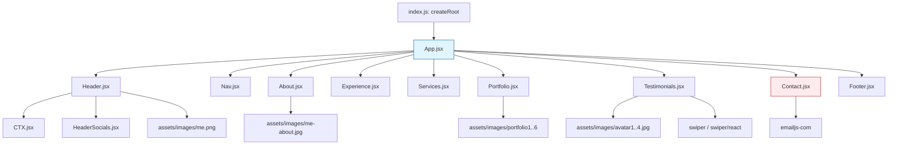
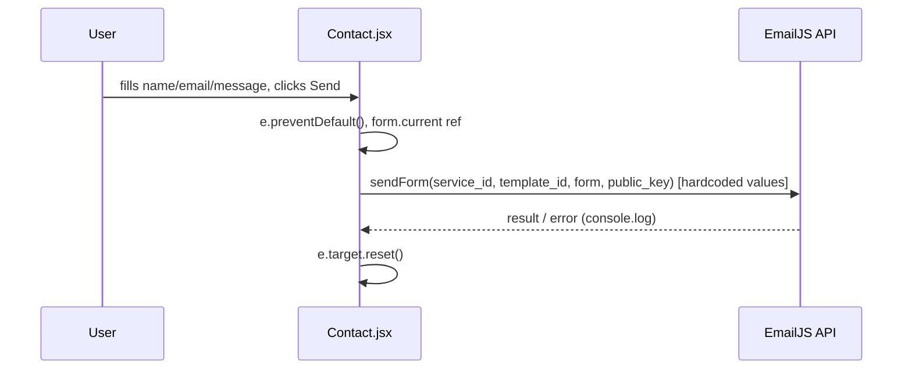
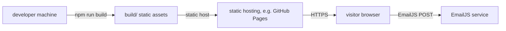

# ARCHITECTURE.md — cv-react

> Source of truth: `projects/repos/cv-react` (HEAD 764ab45, branch `master`). Diagrams are derived from the real source code only; nothing is invented. Items marked **unconfirmed** could not be verified from code alone.

## 1. Business purpose

Personal CV / portfolio single-page application (SPA) for Rasim Aghayev ("FullStack PHP Developer"). Sections: Header, Nav, About, Experience, Services, Portfolio, Testimonials, Contact, Footer. Contact form submits to EmailJS client-side. Downloadable CV PDF. No backend, no database, no authentication.

## 2. Technology stack (from package.json)

| Layer | Package | Version | Role |
|---|---|---|---|
| Runtime | react | ^18.1.0 | UI framework |
| Runtime | react-dom | ^18.1.0 | DOM rendering (`createRoot`) |
| Build | react-scripts | 5.0.1 | Create React App (webpack/babel/jest; maintenance mode, deprecated) |
| Styling | (handwritten CSS) | — | CSS custom properties, one `.css` per component |
| Icons | react-icons | ^4.3.1 | 11 icon sets (fa, fi, bs, ri, si, di, ai, bi, io, vsc, md) |
| Carousel | swiper | ^11.0.0 | Testimonials slider — **critical prototype pollution vuln** (GHSA-hmx5-qpq5-p643) |
| Email | emailjs-com | ^3.2.0 | Contact form submission (deprecated; → @emailjs/browser) |
| Dev | @testing-library/*, web-vitals | ^6/^14/^13 | Installed, not imported in src |

No TypeScript, no router, no state library, no CSS framework.

## 3. Module map (real files)

```
src/
  index.js             # entry: createRoot + root.render(<App/>)
  index.css            # CSS custom properties + global reset
  App.jsx              # shell: renders all 9 sections in fixed order
  components/
    header/
      Header.jsx       # name, title, CTA (Download CV / Let's Talk), photo
      HeaderSocials.jsx# LinkedIn / GitHub / Dribbble links
      CTX.jsx          # CV download + contact buttons
    nav/
      Nav.jsx          # fragment navigation, local useState active tab
    about/
      About.jsx        # About Me (3 stat cards, placeholder text)
    experience/
      Experience.jsx   # frontend/backend skills (icons only)
    services/
      Services.jsx     # 3 service cards ("Lorem impuse dolor" placeholder)
    portfolio/
      Portfolio.jsx    # 6 items (all link to rest-api-php)
    testimonials/
      Testimonials.jsx # Swiper carousel (4 placeholder reviews)
    contact/
      Contact.jsx      # contact form + EmailJS sendForm (hardcoded creds)
  assets/
    images/            # avatars, portfolio images, bg texture, me photos
    pdf/               # Rasim_Aghayev.pdf
public/
  index.html           # <div id="root"> mount point, minimal HTML
```

Each section imports its own `.css` and its own image/assets; sections do not import one another. `App.jsx` is the only aggregator.

Component → dependency map:
- App.jsx → Header, Nav, About, Experience, Services, Portfolio, Testimonials, Contact, Footer
- Header.jsx → CTX.jsx, HeaderSocials.jsx, assets/images/me.png
- Nav.jsx → react-icons (ai, bi, ri); local state only
- About.jsx → react-icons (fa, fi, vsc); assets/images/me-about.jpg
- Experience.jsx → react-icons (bs, fa, si, di) only
- Services.jsx → react-icons (bi) only
- Portfolio.jsx → assets/images/portfolio1..6
- Testimonials.jsx → swiper, swiper/react, swiper/css, assets/images/avatar1..4
- Contact.jsx → emailjs-com, react-icons (md, ri, bs)
- Footer.jsx → react-icons (fa, fi, io)
- index.js → react-dom/client, App, index.css

## 4. Data flow

One-way, static-down; no props flow between sections.

```
User action
   |
   v
[Nav] click #section  ──► setActiveNav (local state, Nav.jsx:8) ──► CSS :active styling (smooth scroll via index.css scroll-behavior)
[Contact] submit ─────► emailjs.sendForm(svc, tmpl, form, pubKey) ──► EmailJS REST API (client-side, no proxy)
[Testimonials] ───────► Swiper carousel (modules={[Pagination]}, hardcoded data)
[CTX/Header] click ───► download Rasim_Aghayev.pdf / scroll to #contact
```

No `process.env`, no `REACT_APP`, no base URL, no API client module. All integration values are hardcoded literals (Contact.jsx:13).

## 5. Diagrams (from real code)

### 5.1 Component hierarchy



### 5.2 Contact form → EmailJS data flow



Note: credentials travel in the client bundle (Contact.jsx:6,13) — see P0-2/P0-3 in REPOSITORY_AUDIT.md.

### 5.3 Navigation flow (fragment-based, unconfirmed scroll target binding)

```mermaid
graph LR
  N[Nav.jsx] -.->|href="#about"| A[section#about]
  N -.->|href="#experience"| E[section#experience]
  N -.->|href="#services"| S[section#services]
  N -.->|href="#contact"| CON[section#contact]
  N -.->|href="#portfolio"| P[section#portfolio]
  N -.->|href="#testimonials"| T[section#testimonials]
  style N fill:#e1f5fe
```

**unconfirmed**: no router library exists; active-section highlighting relies on `useState` + manual class toggling, not on scroll-spy or intersection observation — section-to-nav sync beyond click is unverified.

### 5.4 Deployment topology



**unconfirmed**: no CI/CD, no Docker, no hosting target configured — deployment target is not declared in the repo.

## 6. Verified vs unconfirmed

Verified from code:
- `createRoot` mount (index.js:1,5); no `ReactDOM.render`, no `PropTypes`.
- 9 flat section components, no inter-section props.
- EmailJS hardcoded in Contact.jsx:6,13; swiper in Testimonials.jsx:8-14.
- No env vars, no test files, no Docker/CI/lockfile.

Unconfirmed:
- Intent of the 6 identical Portfolio links (all rest-api-php) — placeholder or deliberate.
- Build behavior on modern Node (no lockfile; `npm ci` impossible) — not yet verified.
- Section-to-nav scroll sync beyond click.
